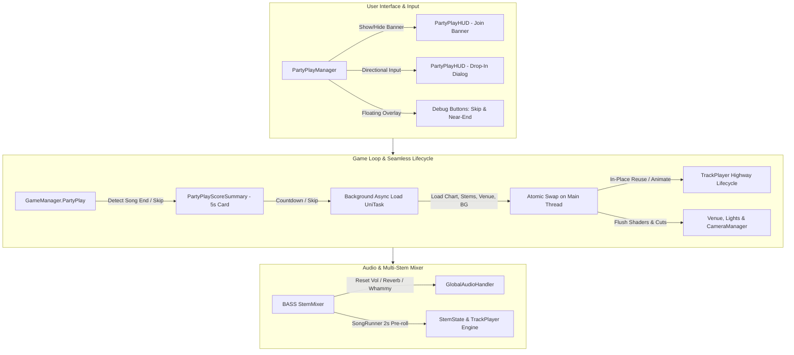

# 🎸 Party Play Concept — Technical Documentation

**Branch:** `PartyPlayConcept`  
**Commit:** `feat(PartyPlay): Implement Party Play mode with seamless song transitions, drop-in/drop-out, and HUD management`

---

## 📌 Executive Summary

**Party Play** is a continuous, arcade-style party game mode for YARG where songs transition seamlessly in the background without returning to menus, loading screens, or freezing gameplay. Players can freely join (*Drop-In*) or leave (*Drop-Out*) at any moment using gamepads, guitars, drums, or keyboards. If a song does not feature a player's selected instrument, that player temporarily sits out with a smooth highway exit animation and automatically drops back in when a matching song arrives.

---

## 🏗️ Architectural Overview

---

## 📂 Detailed File-by-File Breakdown

### 1. Core Party Play Subsystem (`Assets/Script/Gameplay/PartyPlay/`)

#### 📄 [`GameManager.PartyPlay.cs`](file:///c:/repo/YARG-Development/Assets/Script/Gameplay/PartyPlay/GameManager.PartyPlay.cs)
* **Purpose:** Partial class extension of `GameManager` handling the Party Play state machine, dynamic spawning, in-place reloading, and background transition pipeline.
* **Key Mechanisms:**
  - `TransitionPartyPlaySong(SongEntry nextSong)`: Asynchronously loads the new chart, BASS stem mixer, venue lighting, and background texture on a background worker thread (`UniTask.RunOnThreadPool`). When ready, swaps references atomically on the main thread with zero frame-drops.
  - `ReloadTrackPlayer(TrackPlayer player, SongChart chart, StemMixer mixer, ...)`: Re-links notes, beatlines, multiplier combos, and engines into existing player GameObjects without destroying or recreating them.
  - `SpawnPartyPlayer(...)` / `RemovePartyPlayer(...)`: Dynamically manages player highway instantiation and removal mid-song.
  - **Temporary Sit-Out & Auto Drop-In:** If `!Song.HasInstrument(player.Profile.CurrentInstrument)`, the player temporarily sits out for that song without altering their profile instrument. Once a song with their instrument arrives, they automatically re-enter with the entrance animation.
  - **Audio Sanitization:** Terminates lingering volume tweens (`_volumeTween.Kill()`), resets whammy pitch-bends (`0f`), disables Star Power reverb, and re-applies user stem volumes.
  - **Jukebox Mode:** Supports continuous song playback and venue camera sequencing with 0 active players.

#### 📄 [`PartyPlayManager.cs`](file:///c:/repo/YARG-Development/Assets/Script/Gameplay/PartyPlay/PartyPlayManager.cs)
* **Purpose:** Central MonoBehaviour singleton orchestrating user interaction, input interception, and session lifecycle.
* **Key Mechanisms:**
  - `CanAnyPlayerJoin`: Compares created profiles (`PlayerContainer.Profiles`) against active players on track (`_gameManager.Players`). The "Press START to Join" banner appears whenever at least one profile is not currently playing.
  - `OnMenuInput(YargPlayer player, ref GameInput input)`: Captures `Start`, `Green`, `Red`, and D-pad inputs from unassigned gamepads and keyboards to trigger drop-in/drop-out flows.
  - `CheckForFallbackJoinInput()`: Polling fallback for keyboards and non-bound devices.
  - `OnGUI()`: Renders floating bottom-right debug buttons (`⏭` Skip Song, `🏁` Near End Seek) with toggleable visibility in the debug menu.

#### 📄 [`PartyPlayHUD.cs`](file:///c:/repo/YARG-Development/Assets/Script/Gameplay/PartyPlay/PartyPlayHUD.cs)
* **Purpose:** Canvas and UI renderer for Party Play overlay widgets.
* **Key Mechanisms:**
  - Top-center animated banner: `PARTY PLAY - Press [START / ANY BUTTON] to Join!`.
  - Floating drop-in dialog: Allows joining players to select their Profile, Instrument, and Difficulty using guitar fret buttons or gamepad D-pad.

#### 📄 [`PartyPlayHUDController.cs`](file:///c:/repo/YARG-Development/Assets/Script/Gameplay/PartyPlay/PartyPlayHUDController.cs)
* **Purpose:** Coordinates real-time scene refreshes across seamless song transitions.
* **Key Mechanisms:**
  - Displays the Song Title / Artist announcement banner at the start of each new song.
  - Invokes `OnChartLoaded` across `StageManager`, `LightManager`, and `CameraManager` to synchronize lighting events, stage pyrotechnics, and camera cut queues with the new chart.

#### 📄 [`PartyPlayScoreSummary.cs`](file:///c:/repo/YARG-Development/Assets/Script/Gameplay/PartyPlay/PartyPlayScoreSummary.cs)
* **Purpose:** End-of-song score summary card overlay.
* **Key Mechanisms:**
  - Non-intrusive 5-second countdown card displaying Band Score, Star rating, and Full Combo (FC) status.
  - Allows players to press `Start` / `Green` to skip the countdown immediately and start the next song.

#### 📄 [`PartyPlayExtensions.cs`](file:///c:/repo/YARG-Development/Assets/Script/Gameplay/PartyPlay/PartyPlayExtensions.cs)
* **Purpose:** Low-level reflection and extension utilities.
* **Key Mechanisms:**
  - `ReloadTrackPlayer`: In-place chart rebinding and engine instantiation.
  - `MatchesInstrument`: Validates player C# type compatibility (`FiveFretGuitarPlayer`, `DrumsPlayer`, `ProKeysPlayer`, `VocalsPlayer`) against chart instruments.
  - `PlayEnterAnimation` & `PlayExitAnimation`: Animates highways smoothly rising from or folding down into the stage using `CameraPositioner.Raise()` and `Lower()`.
  - `RecreateFailMeter` & `RefreshPlayers`: Reconstructs Rock Meter needles, fill sliders, and happiness calibration on player joins/leaves.

---

### 2. Gameplay & Highway Rendering (`Assets/Script/Gameplay/`)

| File | Type | Description |
| :--- | :--- | :--- |
| [`GameManager.cs`](file:///c:/repo/YARG-Development/Assets/Script/Gameplay/GameManager.cs) | Modify | Added Party Play state checks, enforced `NoFail = true`, and initialized `PartyPlayManager` upon entering gameplay. |
| [`BackgroundManager.cs`](file:///c:/repo/YARG-Development/Assets/Script/Gameplay/BackgroundManager.cs) | Modify | Added `ApplyLoadedBackground(BackgroundResult)` to swap background images and videos live without scene reload. |
| [`HUD/TrackViewManager.cs`](file:///c:/repo/YARG-Development/Assets/Script/Gameplay/HUD/TrackViewManager.cs) | Modify | Added dynamic registration (`AddTrackPlayer`, `AddTrackView`) and removal (`RemoveTrackPlayer`, `RemoveTrackView`, `RemoveVocalTrack`) methods. |
| [`HUD/UnisonBonus/BaseUnisonObject.cs`](file:///c:/repo/YARG-Development/Assets/Script/Gameplay/HUD/UnisonBonus/BaseUnisonObject.cs) | Modify | Added null-safety checks when resetting unison phrases during live song switches. |
| [`Player/TrackPlayer.cs`](file:///c:/repo/YARG-Development/Assets/Script/Gameplay/Player/TrackPlayer.cs) | Modify | Updated `isSongEnd` logic (`!GlobalVariables.State.IsPartyPlay && visualTime > SongLength`) so highways remain raised continuously between songs. |
| [`Visuals/CameraPositioner.cs`](file:///c:/repo/YARG-Development/Assets/Script/Gameplay/Visuals/CameraPositioner.cs) | Modify | Added `SetRaisedImmediate()` and exposed `Raise()` / `Lower()` for fluid highway drop-in / drop-out animations. |
| [`Visuals/HighwayCameraRendering.cs`](file:///c:/repo/YARG-Development/Assets/Script/Gameplay/Visuals/HighwayCameraRendering.cs) | Modify | Corrected depth buffer and camera stack ordering for dynamically added/removed player highways. |

---

### 3. Venue, Lighting & Camera (`Assets/Script/Venue/` & `Integration/`)

| File | Type | Description |
| :--- | :--- | :--- |
| [`VenueCamera/CameraManager.cs`](file:///c:/repo/YARG-Development/Assets/Script/Venue/VenueCamera/CameraManager.cs) | Modify | Reset `_currentCutIndex = 0` and added bounds checking in `SwitchCamera` to prevent `IndexOutOfRangeException`. |
| [`VenueCamera/CameraManager.PostProcessing.cs`](file:///c:/repo/YARG-Development/Assets/Script/Venue/VenueCamera/CameraManager.PostProcessing.cs) | Modify | Added `ResetAllEffectsToDefault()` to flush and reset active post-processing shaders (bloom, contrast, psych, color tints) between songs. |
| [`Lights/LightManager.cs`](file:///c:/repo/YARG-Development/Assets/Script/Venue/Lights/LightManager.cs) | Modify | Reset `_lightingEventIndex = 0`, `_performerEventIndex = 0`, and set `Animation = LightingType.Default` on chart load. |
| [`Stage/StageManager.cs`](file:///c:/repo/YARG-Development/Assets/Script/Venue/Stage/StageManager.cs) | Modify | Cleared `_pyroElements` and `_fogElements` and reset `_stageEventIndex = 0` on new chart loads. |
| [`Integration/MasterLightingGameplayMonitor.cs`](file:///c:/repo/YARG-Development/Assets/Script/Integration/MasterLightingGameplayMonitor.cs) | Modify | Added safety checks and event re-subscriptions for external DMX lighting systems across seamless song switches. |

---

### 4. Menus, Persistent State & Localization

| File | Type | Description |
| :--- | :--- | :--- |
| [`Menu/Main/MainMenu.cs`](file:///c:/repo/YARG-Development/Assets/Script/Menu/Main/MainMenu.cs) | Modify | Added "Party Play" main menu entry, launching random background song playback and opening gameplay directly. |
| [`Persistent/LoadingScreen.cs`](file:///c:/repo/YARG-Development/Assets/Script/Persistent/LoadingScreen.cs) | Modify | Ensured loading screen overlay cleanly dismisses and re-enables navigation inputs when entering Party Play. |
| [`Persistent/PersistentState.cs`](file:///c:/repo/YARG-Development/Assets/Script/Persistent/PersistentState.cs) | Modify | Added `IsPartyPlay` and `PartyPlaySeamlessTransition` boolean state flags. |
| [`Song/SongContainer.cs`](file:///c:/repo/YARG-Development/Assets/Script/Song/SongContainer.cs) | Modify | Added random song retrieval helper for infinite shuffle playback in Party Play. |
| [`StreamingAssets/lang/en-US.json`](file:///c:/repo/YARG-Development/Assets/StreamingAssets/lang/en-US.json) | Modify | Added `"PartyPlay": "Party Play"` string to US English localization. |
| [`StreamingAssets/lang/pt-PT.json`](file:///c:/repo/YARG-Development/Assets/StreamingAssets/lang/pt-PT.json) | Modify | Added `"PartyPlay": "Party Play"` string to Portuguese localization. |

---

### 5. Engine Core Submodule (`YARG.Core`)

| File | Type | Description |
| :--- | :--- | :--- |
| `YARG.Core/Engine/EngineManager.cs` | Modify | Applied `engineContainer.SetNoFail(_noFail)` to dynamically registered engines during mid-song player drop-ins. |

---

## 🚀 Verification and Build Status

- **Branch:** `PartyPlayConcept`
- **Build Status:** ✅ `0 Error(s)`, `5 Warning(s)` (standard engine deprecation warnings).
- **Compilation Command:** `dotnet build YARG-Development.slnx`
